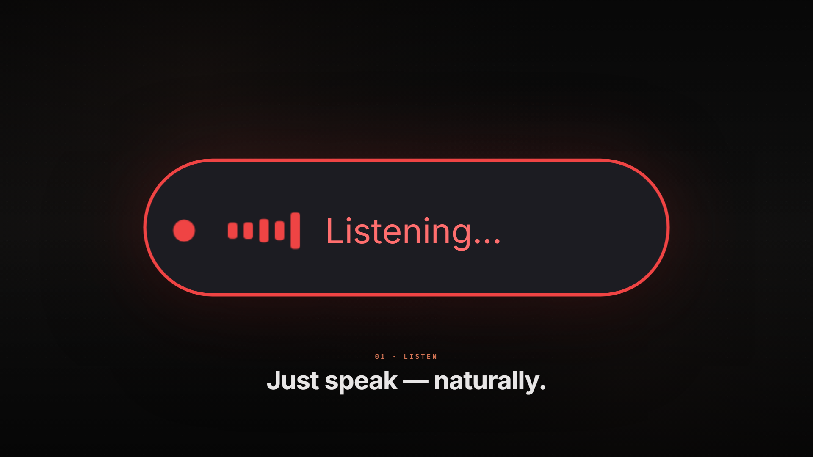
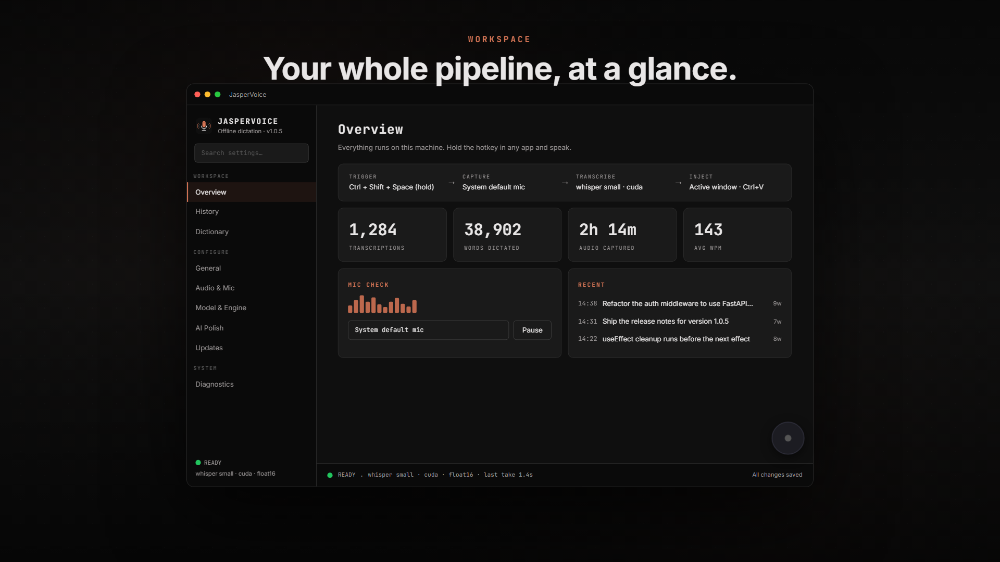

<div align="center">


# JasperVoice

### Push-to-talk dictation that keeps your audio on your machine.

Hold a key. Speak. Release. Whisper transcribes **locally** and the text drops
into whatever app has focus — editor, browser, chat, terminal.
No subscription. No required cloud. No telemetry.

[](#)
[](#)
[](#under-the-hood)
[](#gpu-acceleration)
[](#privacy)
[](#license)

<br/>

<a href="docs/media/JasperVoice-demo.mp4">
  
</a>

<sub>▶ **[Watch the 30-second demo](docs/media/JasperVoice-demo.mp4)** — the overlay pill goes Listening → Processing → Sent while your words type themselves.</sub>

</div>

---

## What it is

JasperVoice is a tiny Windows tray app that turns your voice into text **anywhere**.
Hold `Ctrl+Shift+Space`, talk, and let go — a floating pill mirrors each stage of
the pipeline in real time, then the finished text is pasted into the focused
window. Everything runs on-device with [`faster-whisper`](https://github.com/SYSTRAN/faster-whisper),
so your audio is never uploaded, recorded to a server, or used to train anything.

```
   ┌──────────┐     ┌──────────┐     ┌──────────────┐     ┌──────────────┐
   │  Hotkey  │ ──▶ │  Record  │ ──▶ │  Transcribe  │ ──▶ │    Inject    │
   │  (hold)  │     │   mic    │     │   Whisper    │     │   Ctrl + V   │
   └──────────┘     └──────────┘     └──────────────┘     └──────────────┘
        you             local            on-device            focused app
```

The pill speaks the same language as the pipeline:

| State | Pill | Meaning |
|:--|:--|:--|
| 🔴 **Listening** | red, live spectrum | recording your mic |
| 🟠 **Processing** | amber, slow pulse | Whisper transcribing on-device |
| 🟢 **Sent** | green, decaying bars | text pasted into the active window |

---

## A guided tour

<div align="center">

<a href="docs/media/JasperVoice-tour.mp4">
  
</a>

<sub>▶ **[Watch the app tour](docs/media/JasperVoice-tour.mp4)** — Overview, History, Model &amp; Engine, AI Polish, and the Dictionary.</sub>

</div>

The settings window is a flat, dark **instrument panel**: a sidebar of pages,
hairline-separated rows, a live status bar, and a working settings search. Most
settings apply on **Apply**; startup-only options take effect on the next launch,
while History and Dictionary changes are saved immediately.

---

## Why you'll like it

- **🔒 Private by default.** Audio never leaves the machine. Text leaves *only* if
  you explicitly turn on optional AI polish — and even then, never the audio.
- **⚡ Fast.** `faster-whisper` on CTranslate2, with automatic CUDA acceleration
  and a graceful CPU fallback. ~1–2s for a 5s clip on a modern CPU.
- **🌍 Universal.** Pastes into anything that accepts `Ctrl+V`. No per-app plugins,
  no browser extensions, no integrations to wire up.
- **🪶 Out of the way.** Lives in the system tray behind one hotkey. No windows
  fighting for your screen.
- **📦 Self-contained.** Ships as a per-user installer (no admin) with verified,
  in-app updates.

---

## Features

| | |
|---|---|
| **Push-to-talk** | Global `Ctrl+Shift+Space` (configurable) — hold to record, release to transcribe. |
| **Toggle mode** | Press once to start, again to stop. Accidental taps are debounced. |
| **Local Whisper** | Offline transcription, model sizes `tiny` → `large-v3`. |
| **GPU acceleration** | CUDA in both the dev run and the standalone build, CPU fallback. |
| **Universal injection** | Clipboard + SendInput `Ctrl+V` into the active window. |
| **Animated overlay** | Floating pill with a live audio spectrum driven by real FFT bands. |
| **History & stats** | Words dictated, audio captured, average WPM, searchable history. |
| **Developer dictionary** | Offline phrase → replacement fixes for technical terms. |
| **AI Polish (optional)** | Refine text through any OpenAI-compatible API, local or remote. |
| **Sound feedback** | Optional quiet tones on record start/stop, send, and error. |
| **System tray** | State icons, language switching, settings, stats, and updates. |

---

## Quickstart

### Install (recommended)

No admin, no terminal. Grab the latest `JasperVoice-Setup-<version>.exe` from the
[**Releases**](https://github.com/ynkjohn/JasperVoice/releases) page and run it.
JasperVoice boots straight to the system tray and updates itself from then on.

### Run from source

```powershell
python -m venv .venv
.venv\Scripts\python.exe -m pip install -e .
.venv\Scripts\python.exe -m jaspervoice
```

First run downloads the Whisper `small` model (~460 MB) to
`%APPDATA%\JasperVoice\models\`. The app starts in the tray; the default hotkey
is `Ctrl+Shift+Space`.

---

## Configuration

Everything is editable in the window (tray → **Settings…**). To edit by hand, see
`%APPDATA%\JasperVoice\config.json`:

```json
{
  "hotkey": "ctrl+shift+space",
  "hotkey_mode": "push_to_talk",
  "language": "pt",
  "model_size": "small",
  "compute_type": "int8",
  "device": "auto",
  "sample_rate": 16000,
  "paste_delay_ms": 15,
  "min_recording_ms": 200
}
```

**Languages:** `pt`, `en`, `es`, `auto` (and any ISO 639-1 code).

**Hotkey modes**
- `push_to_talk` *(default)* — hold to record, release to transcribe.
- `toggle` — press once to start, again to stop; a short tap is debounced.

### Developer dictionary

A local, offline list of `phrase → replacement` mappings applied **before** any
AI polish. Matching is case-insensitive, respects word boundaries, and applies
longer phrases first.

```json
{
  "dictionary": [
    { "phrase": "open code", "replacement": "OpenCode" },
    { "phrase": "use effect", "replacement": "useEffect" },
    { "phrase": "fast api", "replacement": "FastAPI" },
    { "phrase": "tail wind", "replacement": "Tailwind" }
  ]
}
```

### AI Polish (optional)

Refine dictation through **any OpenAI-compatible API** after Whisper — local
(Ollama, LM Studio, vLLM) or remote (OpenRouter, OpenCode, cloud). The **AI
Polish** page configures the provider, endpoint, key env-var name, and output
style. A **Test** button diagnoses your setup locally (no network), and **Fetch
models** queries the provider's `/v1/models`.

```json
{
  "post_processing_enabled": true,
  "post_processing_provider": "opencode",
  "output_mode": "prompt",
  "opencode_base_url": "https://your-api.example.com",
  "opencode_api_key_env": "OPENCODE_API_KEY",
  "opencode_fast_model": "DeepSeek V4 Flash",
  "opencode_smart_model": "Qwen3.7 Max"
}
```

> Store the **name** of an environment variable (e.g. `OPENCODE_API_KEY`), never
> the raw `sk-...` key. Only the transcribed text is ever sent — never audio.

---

## GPU acceleration

JasperVoice runs on your NVIDIA GPU when CUDA is available, in both the dev run
and the standalone build.

```powershell
# enable GPU in a source checkout
pip install nvidia-cublas-cu12 nvidia-cudnn-cu12
```

With `"device": "auto"`, transcription tries CUDA first and falls back to CPU if
loading fails. On GPU, `"compute_type": "float16"` is recommended. The
**Model & Engine** page probes your hardware and shows a recommendation. Even
with `auto`, if CUDA loads but a take fails at runtime, the app retries on CPU —
so a single dictation is never lost.

---

## Build & release

```powershell
.venv\Scripts\python.exe -m pip install -r requirements-dev.txt

# one-folder standalone build (boots to tray, no console)
.venv\Scripts\pyinstaller.exe jaspervoice.spec --noconfirm

# full release: PyInstaller + Inno Setup installer + checksums
.\scripts\build_release.ps1
```

`build_release.ps1` writes two artifacts to `dist\installer\`:

- `JasperVoice-Setup-<version>.exe` — the per-user installer.
- `SHA256SUMS` — the checksum the in-app updater verifies before applying.

Publish a GitHub Release tagged `v<version>` with **both** files attached. The
whole release flow is: bump `__version__`, build, upload.

### Auto-update

Tray → **Check for updates…** queries the latest release; if a newer version
exists it downloads the installer, **verifies its SHA-256**, then launches it.
The installer closes JasperVoice, replaces files in place, and relaunches. If
anything fails (offline, checksum mismatch), the running app is untouched.

---

## Privacy

JasperVoice makes **zero** network calls during normal dictation. Its optional
network features are:

1. **Model download** — from Hugging Face when a model is needed.
2. **Updates** — the public GitHub API on startup by default (configurable) or
   when you check manually; installer assets download only after confirmation.
3. **AI Polish** — the transcribed *text* (never audio), only if you enable it.

No analytics. No telemetry. No account.

---

## Under the hood

```
config.py          JSON config at %APPDATA%/JasperVoice/ (validated, atomic writes)
audio.py           sounddevice InputStream → numpy; 7-band FFT feeds the overlay
transcription.py   faster-whisper with CUDA/CPU auto-fallback
injection.py       clipboard + SendInput Ctrl+V
hotkey.py          push-to-talk / toggle state machine on top of `keyboard`
history.py         thread-safe transcription history (JSON, capped at 200)
postprocessing.py  optional OpenAI-compatible text polish
dictionary.py      offline phrase → replacement corrections
tray.py            system tray icon + language/settings/stats/update menu
overlay.py         frameless floating pill (animated, state-colored)
ui.py / ui_pages.py / ui_widgets.py   the navigable settings window
updater.py         GitHub Releases check / download / verify / launch
app.py             wires it all together
```

Each module is small and replaceable. See `openspec/changes/jaspervoice-mvp/`
for the original design rationale.

---

## Known limitations

- **Clipboard is overwritten** on each transcription (restore is planned).
- **Global hotkey may need admin** on first run (Windows low-level keyboard
  hook); run elevated once if push-to-talk doesn't register.
- **Antivirus warnings** about the `keyboard` library are false positives.
- **Single instance** — a named mutex prevents a second copy; quit from the tray.

---

## License

Released under the [MIT License](LICENSE).

<div align="center"><sub>Built for people who'd rather talk than type — without sending their voice to a stranger's server.</sub></div>
